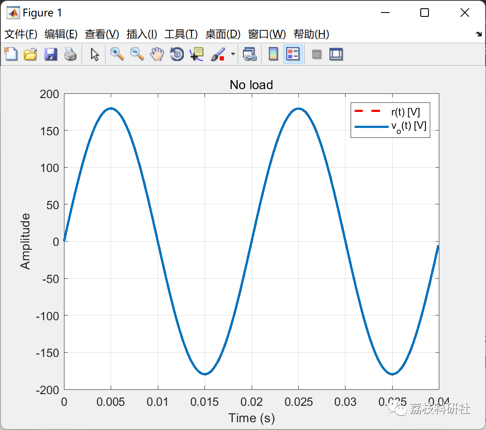
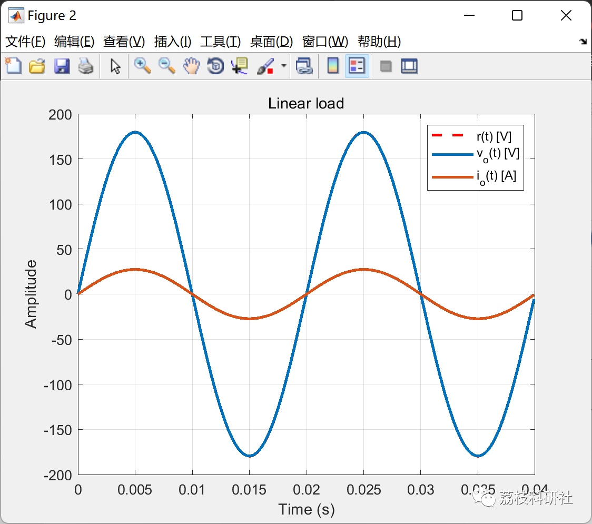
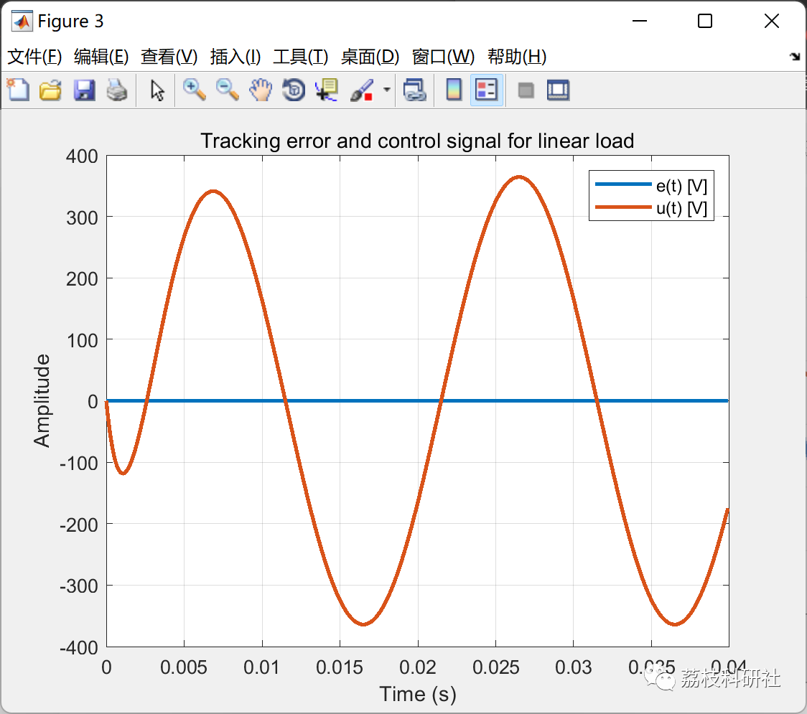
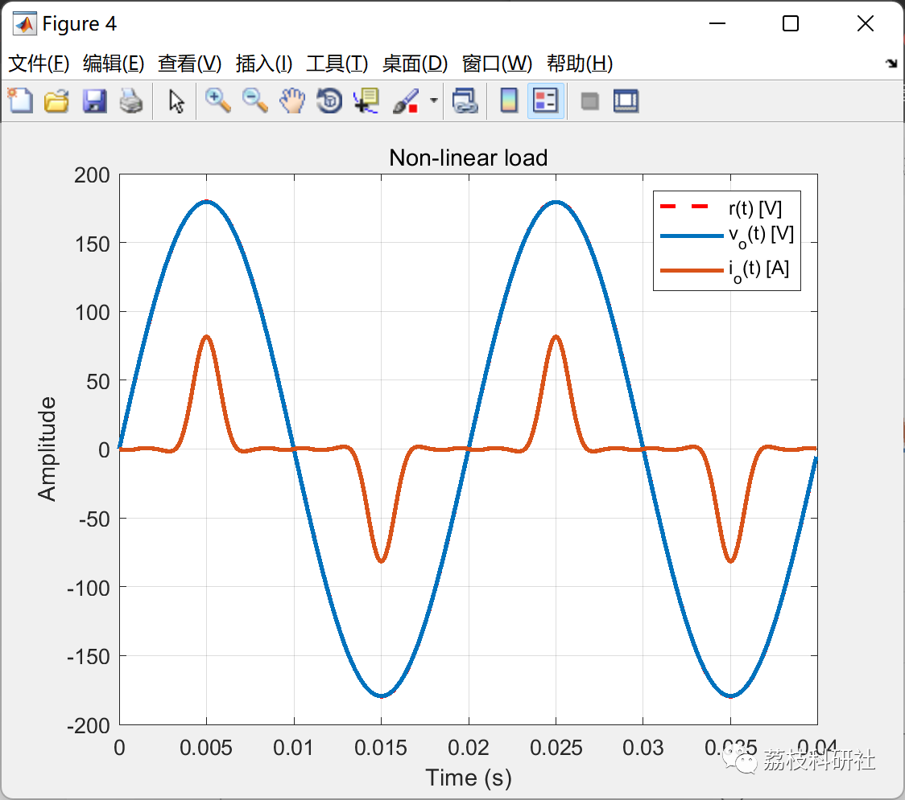
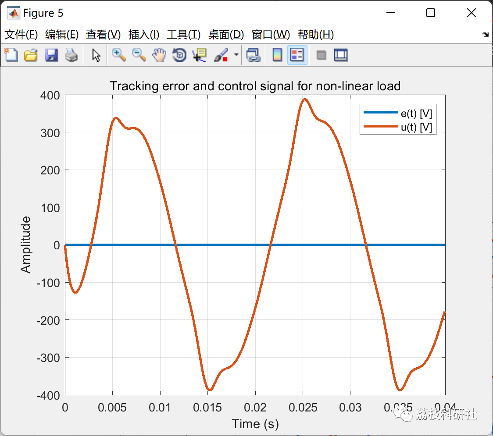
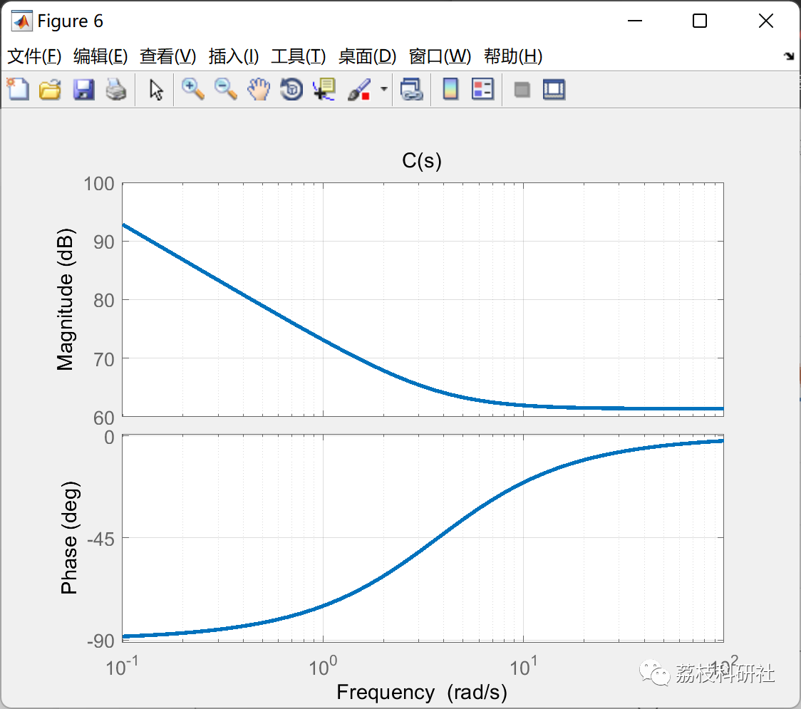

# Proportional-Integral-Derivative (PID) Robust Control and Current Feedback to Ensure the Stability of UPS (Matlab Code Implementation)

💥💥💥💞💞💞 Welcome to this blog❤️❤️❤️ 💥💥💥
🏆 Bloggers' Advantages: 🌞🌞🌞 The content of the blog strives for rigorous thinking and clear logic, making it convenient for readers.
⛳️ Mantra: A journey of a thousand miles is begun with a single step.
Litchi Research Society
Code Collection: Power Systems, Intelligent Algorithms and Applications, Neural Network Prediction, Path Planning, Optimized Scheduling, Workshop Scheduling, Image Processing, Signal Processing...
🎁 Column Directory Link:
🌈🌈🌈🌟🌟🌟 Electrical Code Intelligent Algorithms and Their Applications Path Planning Neural Network Prediction Optimized Scheduling Image Processing Workshop Scheduling Signal Processing Romantic Her Thoughts Math Modeling Complete Code Issues
💥1 Overview
​
The code is used for calculating proportional integral derivative (PID) robust controllers and current feedback gains to ensure the stability and performance of uninterruptible power supplies (UPS). The PID and current gains are tuned in the LMI region by placing robust poles. The output can be drawn without a graphic environment, making research applications easy.
[Tips]Ensure robustness against load changes (boundary). Minimize tracking error but not eliminate. Consider using reference frame transformation or PMR controllers for better response.
📚2 Run Results
🎉3 References
[1]Guilherme Keiel (2022). UPS PID Robust Controller Design.
🌈4 MATLAB Code Realization
Click the article below left bottom [Read More]

## Images

<!-- PAYMENT_BLOCK -->

## Get this dataset

- Payment link (Stripe): [Buy now](https://buy.stripe.com/3cs8yP7sY87d0vu9AB)
- Payment QR code: 

<!-- /PAYMENT_BLOCK -->
